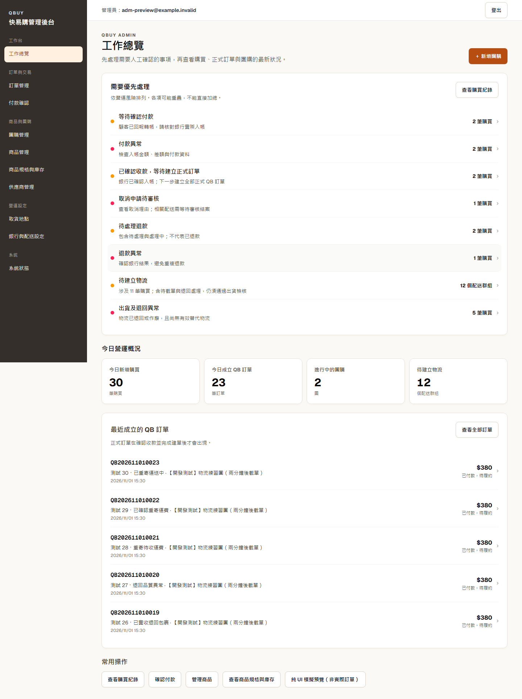
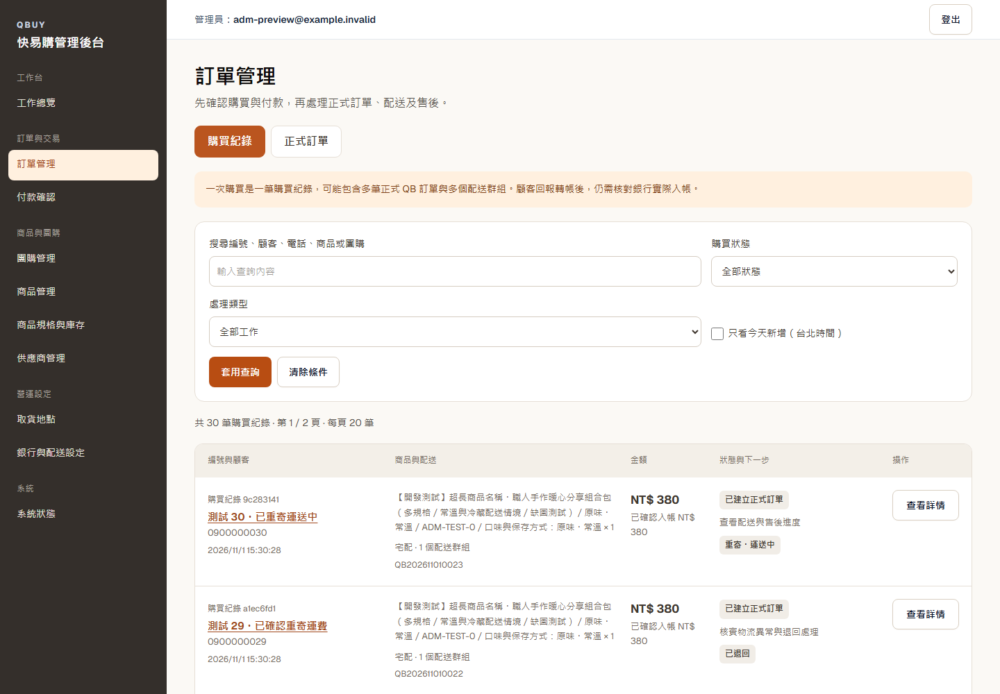
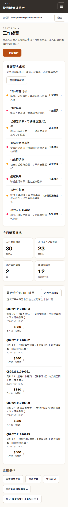
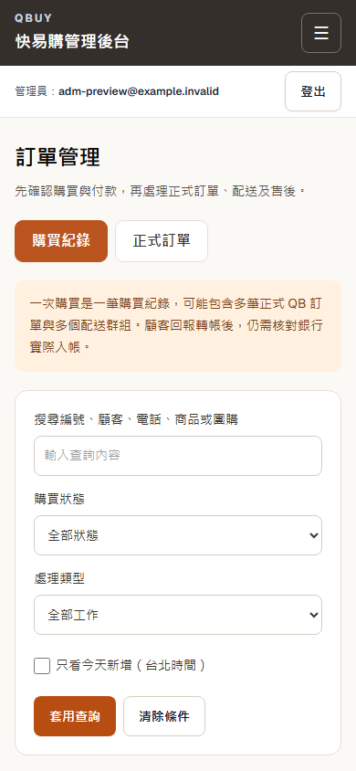
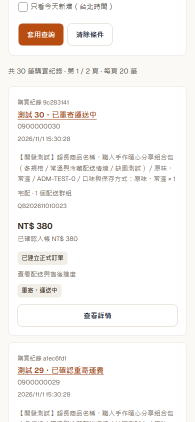
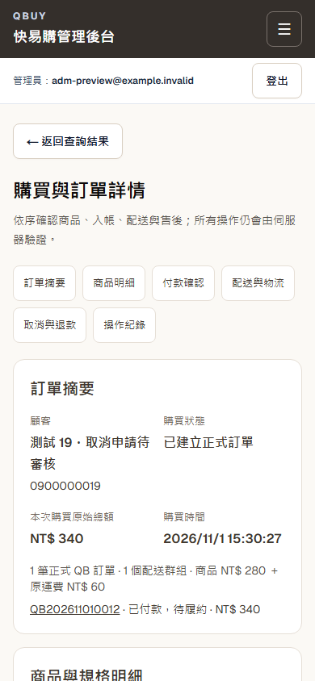

# 實際驗證記錄

2026-11-01，Windows／Node／目前 lockfile，Next.js 16.4.1、Chromium。

| 實際執行指令 | 結果 |
| --- | --- |
| `npm ci` | 成功，未升級依賴 |
| `npm run lint` | 通過；生成的 `.temp`／Playwright 報告排除，所有來源碼仍受檢查 |
| `npm run typecheck` | 通過，含 Prisma generate／Next typegen／TypeScript strict |
| `npm test` | 2045 通過，164 個整合測試在一般 unit 模式按既有旗標跳過 |
| `npm run test:integration:orders` | 167 通過：57＋23＋60＋27；使用 runner 自建並清理的隔離 DB |
| `npm run test:integration:auth` | 23 通過：8＋15；使用隔離 DB |
| `npm run build` | production build 成功 |
| `npm run test:e2e` | 完整 22 項 Chromium 通過（約 2.6 分鐘） |
| `npm run adm:preview:seed` | 新建 30 Checkout／23 QbOrder／31 FulfillmentGroup；第二次重用，不新增或覆蓋 |
| `npm run adm:preview:verify` | 30 情境、台北今日數量、分頁不重複、空資料、各佇列、部分取消配送計數、庫存與無外部通知送出通過 |
| `npm run adm:preview:test` | 8 項 Chromium 通過，約 1.1 分鐘 |
| `npm audit --json` | 16 moderate、0 high、0 critical；退出碼 1，未自動升級依賴，需另案處理 |
| `git diff --check` | 通過 |

完整 Playwright 包含消費者首頁、圖片比例、缺圖、分類篩選、多 SKU、購物車、結帳、我的訂單、協助頁與 Footer；也覆蓋 ADM 人工核帳、建單、取消、退款處理中→已退款、物流、退回實收、品檢、收取重寄費與重寄，確認操作後重新顯示服務端狀態。舊制測試改用保留的 `/admin/orders` 直接入口，不要求重新放回主要導覽。

新增的資料投影整合回歸驗證：同一次購買有兩個獨立配送群組，取消其中一團後只剩一組待建物流；退回案件建立有效重寄物流後，不再出現在待建物流／出貨異常。沒有調整服務端交易規則。

ADM 專用測試逐一驗證 320／375／390／768／1024／1440px：工作總覽、導覽顯示、抽屜背景捲動鎖、Tab／Shift+Tab、Escape 與返回焦點、快速開關、跨斷點清理、搜尋、狀態篩選、20＋10 分頁、保留查詢條件、正式訂單視圖、長名稱、空資料、詳情展開及無水平溢位。30 筆真實詳情逐一開啟；直接路由、無效識別碼、未登入重新導向、全部後台導覽與銀行設定展開均通過。畫面沒有 pageerror。

## 修正過程中發現的失敗

- 初次隔離 DB 以一般表格儲存擁有權，Prisma P3005 拒絕非空資料庫；改用 PostgreSQL database COMMENT，清理且只重建本任務自己的隔離 DB。
- 初次假門市流程的 slug 不符合既有 `gb-<16 chars>` 格式；改用合法 slug，未放寬驗證。
- #77 及舊 E2E 沿用「營運首頁」「取貨地點管理」「銀行與配送設定」與內嵌訂單詳情入口；更新成目前文字及詳情路由，保留交易斷言。
- 手機抽屜原生 dialog 的鍵盤循環不足以符合指定操作；加上首尾 Tab 循環，重新測試通過。
- 一次完整 E2E 在同時重建／型別產物更新期間出現伺服器連線中斷；停止預覽並固定程式與產物後，完整 22 項重新通過。最終回歸沒有並行重建。
- ESLint 掃入生成的 Playwright trace 壓縮檔；只排除生成報告，重新 lint 通過，未降低來源碼規則。

- GitHub CI 曾捕捉到舊測試以隨機 UUID 作銀行參考號，偶爾含連續 10 位數字而被既有防完整帳號驗證拒絕。整合與 seed 改用現有 `syntheticBankReference`（數字段最多 8 位），加上全數字 UUID 的確定性回歸；不放寬驗證。

## 實際截圖

以下為本機隔離合成資料；隱藏 Next 開發工具浮層，未修改產品畫面。

桌面工作總覽：

桌面購買紀錄：

手機工作總覽：

手機查詢條件、訂單卡片與詳情：

## 待人工確認與界線

- 本輪保留 Draft，等待實際營運人員確認資訊層級與下一步用語。
- 付款確認完整頁、商品、團購、庫存、供應商與物流工作台沒有全面重構；保留功能及共用基礎 UI，留待下一輪逐頁確認。
- 沒有實際銀行、物流商或 LINE 推播驗收；本輪故意停用所有外部送出。
- 不修改正式服務條款或隱私權內容；既有未核定政策仍維持未發布。
- 原目錄 105 項既有工作與另一 worktree 的 Footer focus 修正仍保留，不放進本 ADM 提交。
- 原生觸控以 Chromium touch emulation 驗證；未聲稱實體 iPhone／Safari 或 Android 裝置測試通過。
